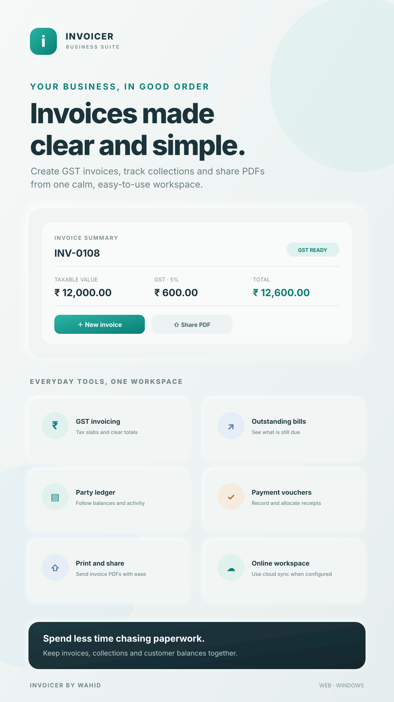
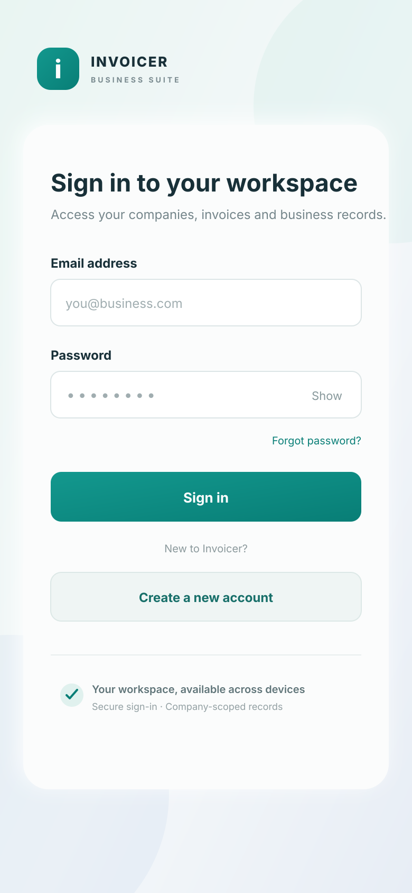
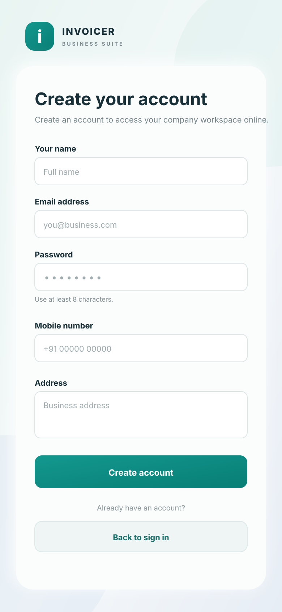
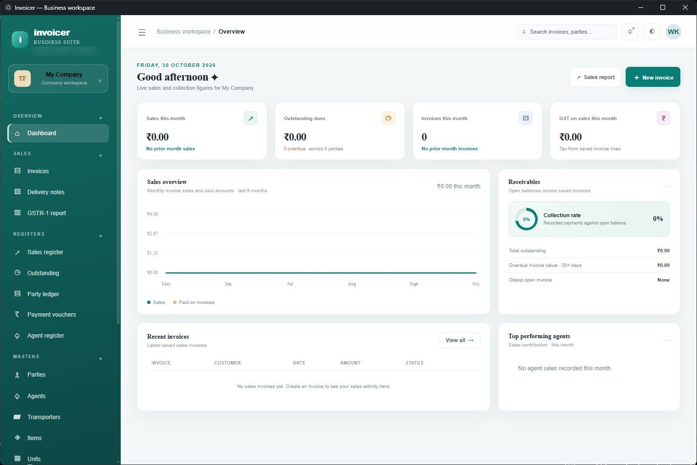
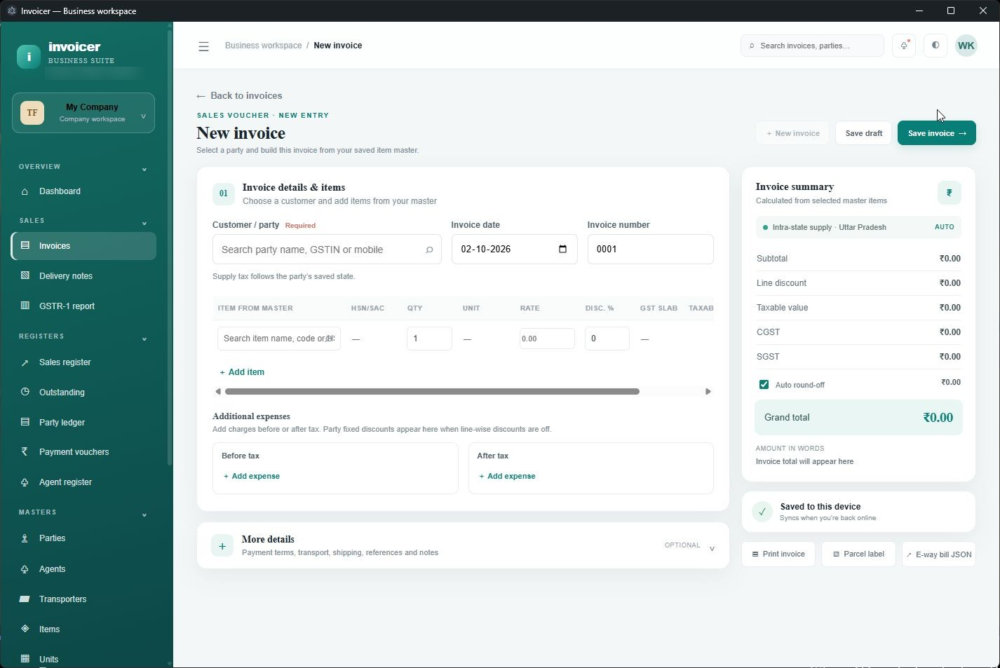
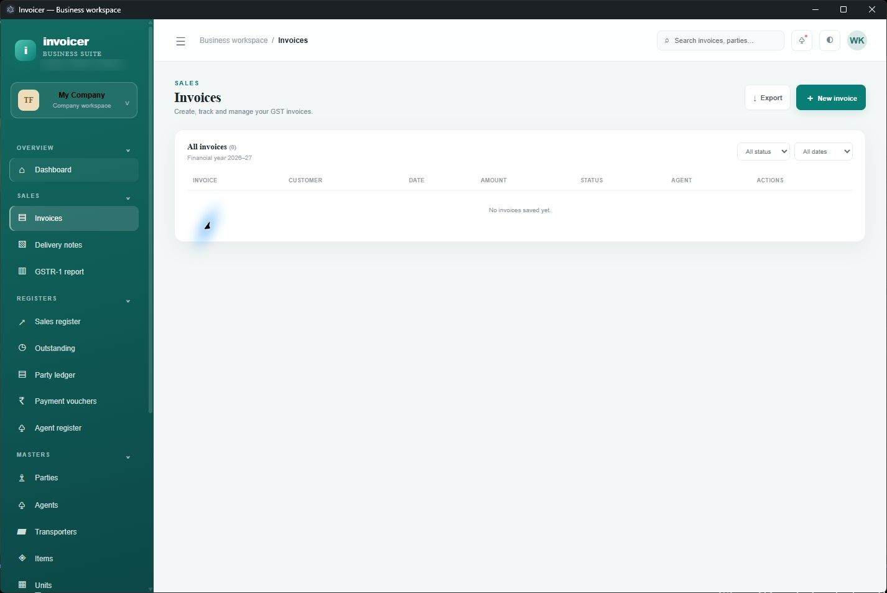
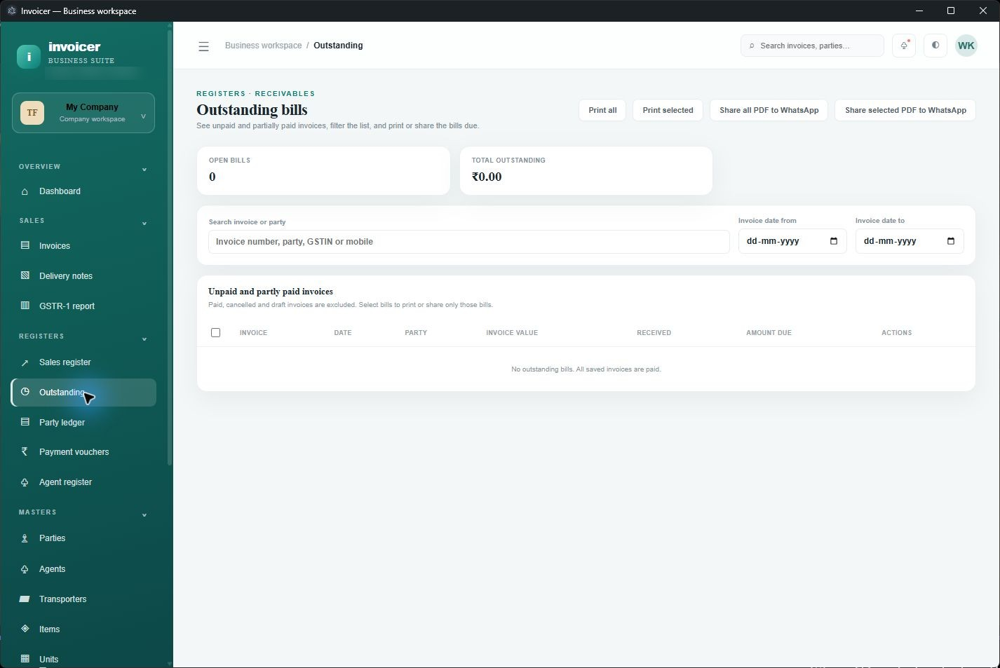
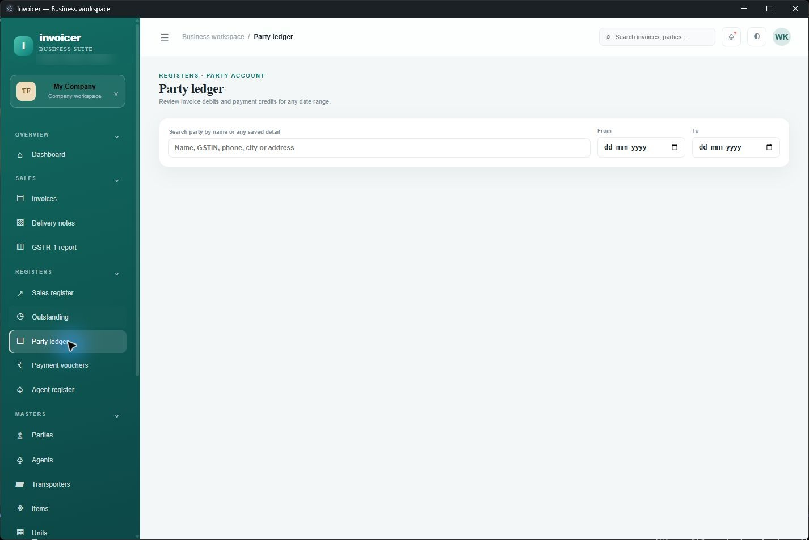
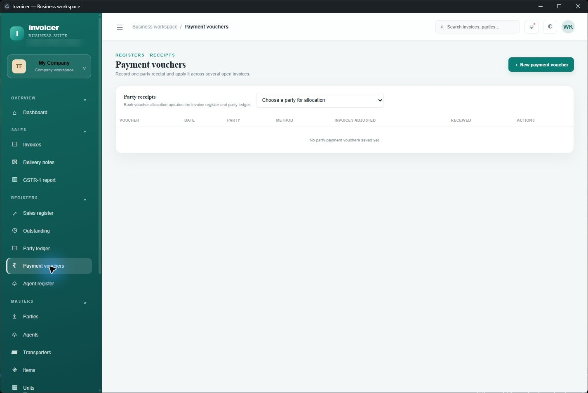

# INVOICER by wahid

**Cross-platform invoicing and GST workflow for small businesses.** Run the app in a browser or Windows desktop, create invoices, track collections, and manage party balances. When configured, both clients share Supabase data; desktop installations can also keep a local database file for offline access.

## Client sign-in and account creation

These clean client-flow screen visuals show the sign-in and new-account steps. Fields are intentionally blank.

| Sign in to a workspace | Create a client account |
| --- | --- |
|  |  |

## App screenshots

## Screenshots

The screenshots below show the current app interface. The workspace used for these captures has no saved business records yet, so registers and totals are empty.

### GST invoice entry

### Invoice register

### Outstanding bills

### Party ledger

### Payment vouchers

## Download for Windows

Open the [latest GitHub release](https://github.com/wahid0018/invoicer-by-wahid/releases/latest) and choose the installer that fits:

- **Offline setup** — `Invoicer-Business-Suite-Setup-1.0.11.exe`; includes the app package.
- **Web setup** — `Invoicer-Business-Suite-Web-Setup-1.0.11.exe`; a small installer that downloads the app package during setup.

The app includes its own Electron runtime. You do not need to install Node.js separately.

## Features

- Create and print GST invoices with configurable GST-inclusive or GST-exclusive rates, taxable line amounts, GST slabs, and a tax summary before the total.
- Track sales, due invoices, and party balances in sales, outstanding, and ledger registers.
- Record payment vouchers and allocate receipts against outstanding invoices.
- Share invoice and register PDFs through WhatsApp.
- Maintain parties, items and services, units, agents, transporters, company details, and invoice or delivery settings.
- Create delivery notes and export e-way bill JSON data.
- Save work in a local `.invoicerdb` file with backup and restore tools.
- Create a local database as part of offline account signup, or let Supabase create the online company workspace during cloud signup.
- Check GitHub Releases for app updates.
- Sign in to a shared Supabase workspace from the web app and configured desktop builds.

## Data and tax notes

Cloud sync is enabled after a Supabase project is configured and its SQL files are applied. The current compatibility layer synchronizes company-scoped app records with version checks; simultaneous edit conflicts are reported instead of silently overwritten. Desktop builds can keep a `.invoicerdb` cache for local use. Keep a separate backup of local database files.

GSTR-1 and e-way bill outputs are provided as workflow tools and should be checked before statutory use. The app is not a certified tax filing service.

## Documentation

- [Configure Supabase, Netlify, and desktop cloud access](docs/CLOUD_SETUP.md)
- [Install the Windows app](INSTALLATION.md)
- [Features and limitations](FEATURES_AND_LIMITATIONS.md)
- [Database, backup, and privacy](DATA_AND_BACKUP.md)
- [App updates](UPDATES.md)

The web application source and Supabase deployment setup are included in this repository. See [Cloud setup](docs/CLOUD_SETUP.md) to configure Supabase and connect the repository to Netlify.
